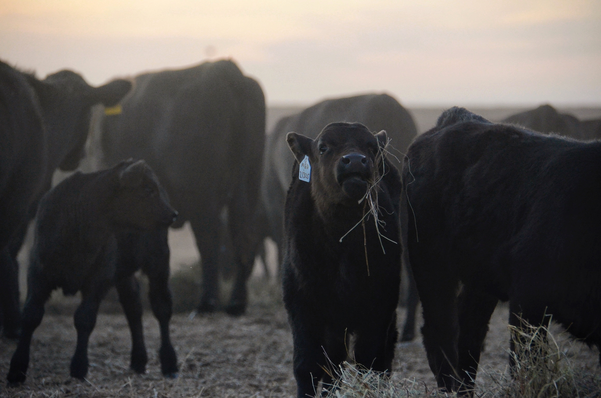

<div style="width:100%; text-align:center; margin-bottom: 1rem;">
  
</div>

Calves should get a **5-Way Respiratory** and a **7-Way Clostridial** vaccine **2 times** between 30 days of age and weaning.

## Pick one schedule

```{=html}
<table class="lvr-vax-schedule">
  <thead>
    <tr>
      <th></th>
      <th>Turnout</th>
      <th>Pre-Weaning</th>
      <th>Weaning</th>
    </tr>
  </thead>
  <tbody>
    <tr>
      <th scope="row">Option 1</th>
      <td><span class="lvr-vax-chip lvr-vax-resp">5-Way</span><span class="lvr-vax-chip lvr-vax-clos">7-Way</span></td>
      <td><span class="lvr-vax-chip lvr-vax-resp">5-Way</span><span class="lvr-vax-chip lvr-vax-clos">7-Way</span></td>
      <td class="lvr-vax-none">&mdash;</td>
    </tr>
    <tr>
      <th scope="row">Option 2</th>
      <td><span class="lvr-vax-chip lvr-vax-resp">5-Way</span><span class="lvr-vax-chip lvr-vax-clos">7-Way</span></td>
      <td class="lvr-vax-none">&mdash;</td>
      <td><span class="lvr-vax-chip lvr-vax-resp">5-Way</span><span class="lvr-vax-chip lvr-vax-clos">7-Way</span></td>
    </tr>
    <tr>
      <th scope="row">Option 3</th>
      <td class="lvr-vax-none">&mdash;</td>
      <td><span class="lvr-vax-chip lvr-vax-resp">5-Way</span><span class="lvr-vax-chip lvr-vax-clos">7-Way</span></td>
      <td><span class="lvr-vax-chip lvr-vax-resp">5-Way</span><span class="lvr-vax-chip lvr-vax-clos">7-Way</span></td>
    </tr>
  </tbody>
</table>

<p class="lvr-vax-footnote">Allow at least 3 weeks between pre-weaning and weaning shots.</p>

<h2>What to buy</h2>

<div class="lvr-vax-grid">
  <div class="lvr-vax-card lvr-vax-card-resp">
    <h3><span class="lvr-vax-chip lvr-vax-resp">5-Way</span> Respiratory</h3>
    <p class="lvr-vax-covers">IBR, BVD Types 1 &amp; 2, PI3, BRSV</p>
    <p class="lvr-vax-label">Examples</p>
    <ul>
      <li>Bovi-Shield Gold 5</li>
      <li>Pyramid 5</li>
      <li>Express 5</li>
      <li>Vista 5</li>
      <li>Titanium 5</li>
    </ul>
  </div>
  <div class="lvr-vax-card lvr-vax-card-clos">
    <h3><span class="lvr-vax-chip lvr-vax-clos">7-Way</span> Clostridial</h3>
    <p class="lvr-vax-covers">Blackleg and related clostridial diseases</p>
    <p class="lvr-vax-label">Examples</p>
    <ul>
      <li>Ultrabac 7</li>
      <li>Vision 7</li>
      <li>Alpha-7</li>
      <li>UltraChoice 7</li>
      <li>Covexin 8</li>
    </ul>
  </div>
</div>

<h2>Optional</h2>

<div class="lvr-vax-optional">
  <div class="lvr-vax-opt">
    <p class="lvr-vax-opt-name">Inforce 3</p>
    <p>Faster protection and better protection in young calves. Particularly good for BRSV.</p>
  </div>
  <div class="lvr-vax-opt">
    <p class="lvr-vax-opt-name">Pasteurella</p>
    <p>Bacterial pneumonia vaccine, such as Presponse or One Shot.</p>
  </div>
  <div class="lvr-vax-opt">
    <p class="lvr-vax-opt-name">Pinkeye</p>
    <p>Variable efficacy at best.</p>
  </div>
  <div class="lvr-vax-opt">
    <p class="lvr-vax-opt-name">Scours</p>
    <p>Medgene is recommended because it has current rotavirus strains. Efficacy is not good.</p>
  </div>
</div>
```

::: lvr-page-cta
**Questions?** Call LVR at [(785) 333-8384](tel:+17853338384) — we're glad to help.
:::
